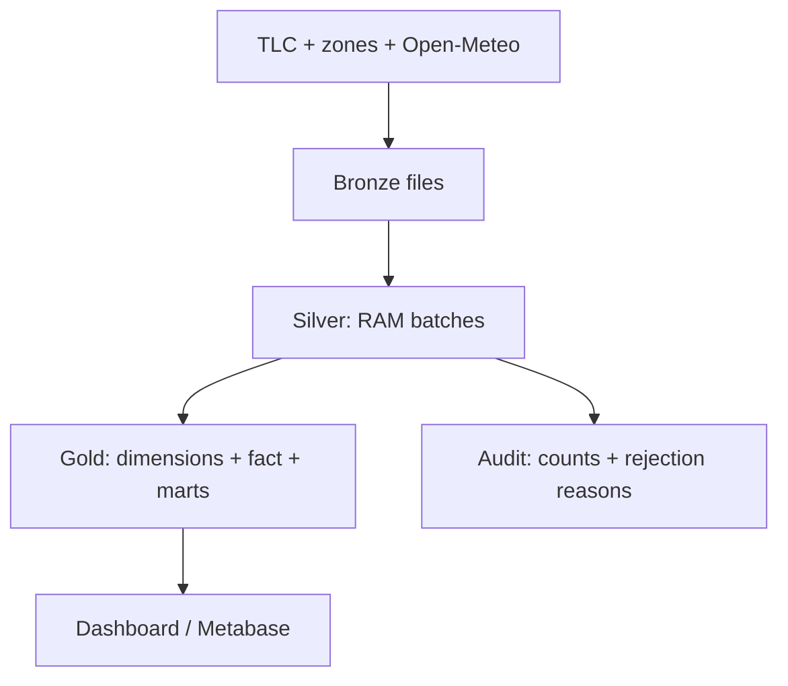

# Kiến trúc & hợp đồng dữ liệu

Đây là biến thể Medallion theo yêu cầu dự án: Silver là **lớp xử lý logic không persist**. Không nên phát biểu rằng mọi Medallion đều cấm lưu Silver.

Airflow điều phối ingest → transform/load → verify; transform/load phải nằm cùng một process để không lưu Silver giữa các task. Không truyền DataFrame qua XCom. `schedule=None` là chủ ý: TLC công bố dữ liệu có độ trễ; trigger tháng đã có dữ liệu thay vì tự chạy tháng chưa công bố.

| Object | Grain / khóa | Ý nghĩa |
|---|---|---|
| gold.dim_zone | location_id | Bao gồm mã unknown nếu có trong lookup chính thức |
| gold.dim_weather_hour | giờ địa phương New York | Nhiệt độ/mưa trung bình của các observation cùng giờ địa phương |
| gold.fact_trip | data_month + source_row | Một dòng nguồn hợp lệ; không hash thuộc tính để deduplicate |
| gold.agg_daily_demand | tháng + ngày pickup | Count, tổng total_amount, khoảng cách/thời lượng trung bình |
| gold.agg_zone_demand | tháng + pickup zone | Count và tổng total_amount |
| gold.agg_hourly_weather | tháng + giờ địa phương | Demand + weather; có cả giờ 0 chuyến |
| audit.pipeline_runs | run_id | Running/success/failed, checksum, số dòng, thời điểm hoàn thành |
| audit.rejections | run_id + source_row | Lý do loại; lấy dòng gốc từ Bronze khi cần |

## Reliability

- Download atomically: ghi .tmp, đổi tên khi hoàn tất; HTTP retries.
- Ingestion cache tránh download lại, `--force` tải lại nguồn. Khi sửa Bronze, rerun thay toàn bộ tháng.
- Ghi Gold bằng COPY theo batch; không giữ toàn tháng taxi trong RAM.
- Transaction bao gồm dim updates, xóa/thay tháng fact, rebuild 3 marts, rejection lineage, audit success.
- Advisory lock serialize writers; người đọc thấy bản cũ hoặc bản mới sau commit.
- Injected failure sau COPY chứng minh rollback, audit failed được ghi ngoài transaction lỗi.
- Không coi hai trip có timestamp/fare/zone giống nhau là cùng một chuyến: source row giữ cả hai.
- PostgreSQL PK/FK/check constraints, chỉ mục pickup time và zone.
- Tài khoản metabase_reader chỉ SELECT Gold; bind cổng localhost.

## Quy tắc chất lượng

Loại timestamp lỗi; pickup ngoài tháng; duration <=0 hoặc >24h; zone không có trong lookup; distance/fare/total null, vô cực hoặc <=0; distance >300 miles; tốc độ >100 mph. Các ngưỡng này là quy tắc phân tích của nhóm, không phải quy định TLC. Refund/zero-fare bị loại, nên Gold là tập hợp phục vụ phân tích đã lọc, không phải sổ kế toán toàn bộ hoạt động.

Passenger/payment/tip là tùy chọn: giữ NULL nếu thiếu hoặc không hợp lệ. Không lấy NULL passenger làm lý do xóa một trip. Bronze = Gold accepted + rejected cho từng run thành công.

## Thời gian và weather

TLC timestamp được xử lý như giờ địa phương America/New_York. Dữ liệu không có UTC offset nên không suy ra chắc chắn hai lần xuất hiện của giờ lặp DST. Join theo giờ địa phương, collapse weather overlap bằng mean và ghi observations=2; trip mang dst_ambiguous=true. Không tuyên bố UTC join chính xác cho giờ lặp. Weather lấy UTC đến ngày kế tiếp để đủ cuối tháng New York; kiểm tra coverage trước khi ghi Gold.

Weather là một điểm tham chiếu Manhattan, không đo riêng từng zone. Avg trips/hour bao gồm cả giờ 0 trips; không diễn giải correlation thành causation. `total_amount` là tổng phí hành khách, không phải profit; cash tips không đầy đủ.

## Mô-đun

- `src/ingestion/`: tải Bronze; kế thừa và sửa từ starter.
- `src/processing/silver.py`: validate/normalize trong RAM.
- `src/pipeline.py`: điều phối và transaction Gold.
- `src/verify.py`: reconcile facts/marts/audit, weather coverage, không staging.
- `src/dashboard.py`, `dashboard/index.html`: dashboard read-only.
- `airflow/dags/nyc_taxi_monthly.py`: automation.
- `dbt/`: presentation view + tests trên Gold; không bắt buộc cho pipeline chính.

## Nguồn

- https://www.nyc.gov/site/tlc/about/tlc-trip-record-data.page
- https://www.nyc.gov/assets/tlc/downloads/pdf/data_dictionary_trip_records_yellow.pdf
- https://open-meteo.com/en/docs/historical-weather-api
